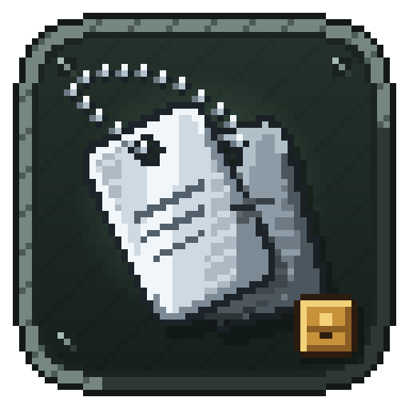
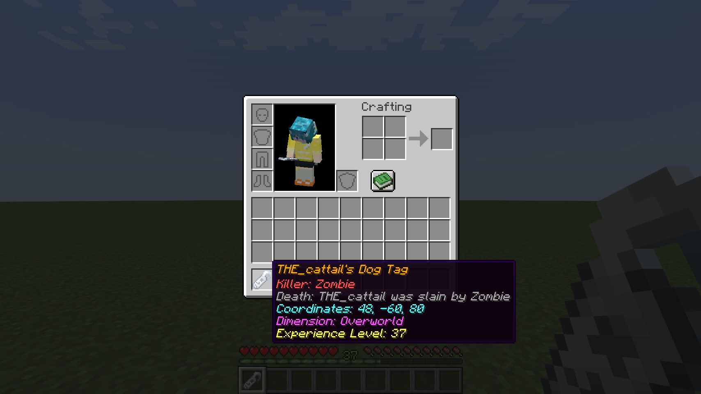
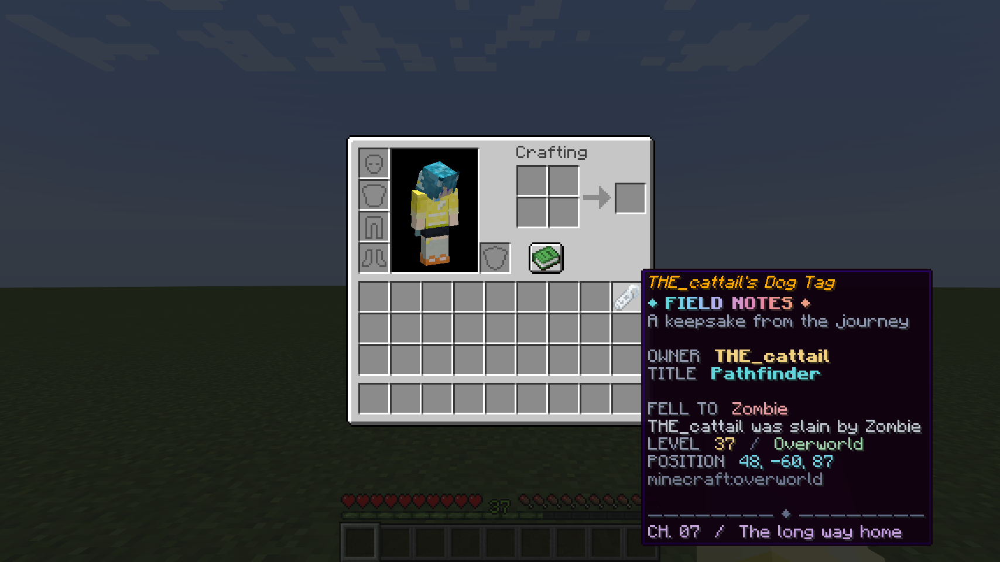

# Kill Confirmed



Kill Confirmed creates a dog tag when a player dies, for records or keepsakes.

## Configuration

First launch creates `config/kill_confirmed.toml`. Edit it with the game/server stopped, then restart. On a server, only the server's configuration is used. Changes affect new tags; existing tags keep their recorded text.

```toml
# Where the dog tag goes: "death_position" (drops where you died) or "respawn_inventory" (given to you on respawn)
drop = "death_position"
# Only create a dog tag when another player is the killer
player_kills_only = false
# Optional mcfunction id, run as the dead player at the death position (permission level 2, output silenced) right before the tag is built.
# Use it to fill scoreboards/storage, then read them in lore with vanilla "score"/"nbt" text components.
function = ""
# One entry per lore line, each a JSON text component. {"placeholder":"<name>"} inserts a value.
# A line that uses a placeholder with no value (e.g. killer on an environmental death) is hidden.
lore = [
  '{"placeholder":"death_message","color":"gray","italic":false}',
  '{"text":"","color":"gray","italic":false,"extra":[{"placeholder":"x"},{"text":", "},{"placeholder":"y"},{"text":", "},{"placeholder":"z"},{"text":"  "},{"placeholder":"dimension","color":"#808080"}]}',
  '{"translate":"kill_confirmed.lore.level_day","color":"#808080","italic":false,"with":[{"placeholder":"level","color":"#E2C88C"},{"placeholder":"day","color":"#E2C88C"}]}',
]
```

`drop` accepts `death_position` (default) or `respawn_inventory`. `player_kills_only = true` limits tags to deaths caused by another player. Death-position tags follow normal item physics: they can be destroyed in lava or the void. Use `respawn_inventory` to keep them out of those hazards.

Each `lore` string is one vanilla JSON text component. `{"placeholder":"name"}` inserts a component recursively, including inside `extra` and `with`; styles on the placeholder object override that value's styles. Any missing value hides the whole line. Invalid JSON/components hide that line and log one warning with its line number.

| Placeholder | Value |
| --- | --- |
| `player` | Deceased player's name |
| `killer` | Killer's display name; absent without a killer |
| `weapon` | Killer's main-hand item name; absent with an empty hand or no killer |
| `death_message` | Unmodified vanilla death-message component |
| `x`, `y`, `z` | Integer death block coordinates |
| `dimension` | Localized dimension name, falling back to its ID |
| `level` | Experience level at death |
| `day` | World day: `level.getDayTime() / 24000 + 1` |

Vanilla `score`, `nbt` and `selector` components resolve as the deceased player at the death position. The optional `function` runs first with permission level 2 and suppressed output, including when another function caused the death. The old JSON configuration and datapack provider protocol are no longer used; an old configuration causes one startup warning and is not migrated.

### Add a custom line with a function

For Minecraft 1.21.1, create `world/datapacks/tag_stats/pack.mcmeta`:

```json
{"pack":{"pack_format":34,"description":"Dog tag statistics"}}
```

Create `world/datapacks/tag_stats/data/example/function/dog_tag.mcfunction`:

```mcfunction
scoreboard players set @s kc_kills 7
```

Run `/scoreboard objectives add kc_kills dummy` once, then `/reload`. Set `function = "example:dog_tag"` in the TOML and append this string inside its `lore` array:

```toml
  '{"text":"Kills: ","color":"#808080","italic":false,"extra":[{"score":{"name":"@s","objective":"kc_kills"},"color":"#E2C88C"}]}'
```

After restarting, new tags include `Kills: 7`. Replace `7` in the function with your own calculation. For 26.x, use the datapack format for your Minecraft version (listed in `profiles.json`). A complete [configuration and datapack](docs/examples/showcase/) is included.

## Requirements

RinLib is bundled; no separate installation is required.

## Earlier layouts

**Default information**



**Customized information**


