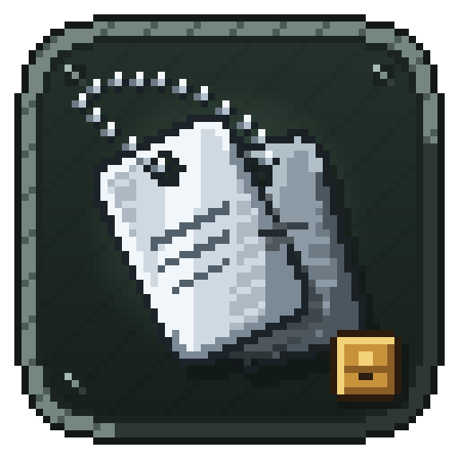
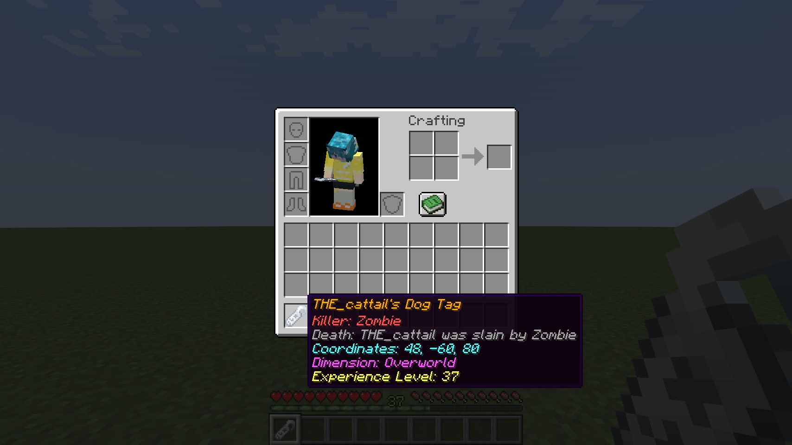
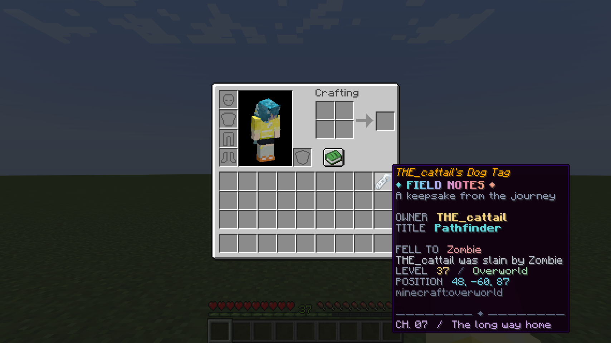

# Kill Confirmed

Kill Confirmed 会在玩家死亡时生成一枚狗牌，可用于记录或纪念。

## 工作方式

- 每次真实玩家死亡生成一枚狗牌，记录死者名字、死亡原因、位置、维度和等级。
- 默认掉在死亡位置。设置 `drop = "respawn_inventory"` 可改为复活时放进背包。
- 狗牌的每一行 lore 都是一个 JSON 文本组件，取值缺失的那一行会隐藏。
- 修改配置只影响新狗牌，已有狗牌保留生成时的文本。

## 配置

配置文件是 `config/kill_confirmed.toml`，首次启动时生成。关闭游戏或服务器后修改，然后重启。多人游戏只读服务端的配置。

| 键 | 默认值 | 作用 |
| --- | --- | --- |
| `drop` | `"death_position"` | `death_position` 掉在死亡位置；`respawn_inventory` 复活时放进背包。 |
| `player_kills_only` | `false` | 为 `true` 时，只有被其他玩家击杀才生成狗牌。 |
| `function` | `""` | 可选的函数 ID。在生成狗牌前以死者身份在死亡位置运行（权限等级 2，输出静默）。 |
| `lore` | 三行：死亡信息、坐标与维度、等级与天数 | 每行一个 JSON 文本组件。`{"placeholder":"名称"}` 插入一个值。 |

`lore` 可用的占位符：`player` 死者名字，`killer` 击杀者名字（无击杀者时不显示），`weapon` 击杀者主手物品名（空手或无击杀者时不显示），`death_message` 原版死亡信息，`x`、`y`、`z` 死亡坐标，`dimension` 维度名，`level`、`day` 等级和世界天数。

## 兼容性

- Minecraft 1.20.1、1.21.1、26.1.2、26.2、26.3
- Fabric、Forge 和 NeoForge
- 零外部依赖，单 JAR 独立运行。

## 下载

- [GitHub Releases](https://github.com/rinchan-hoshino/kill-confirmed/releases)
