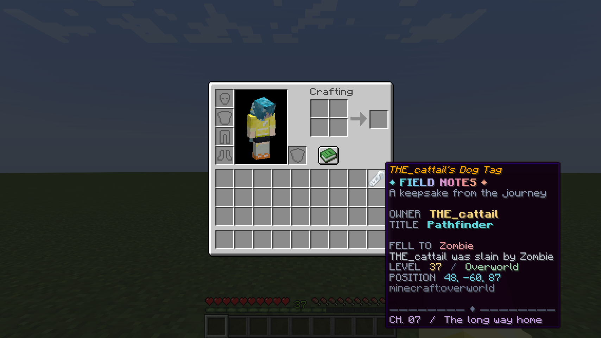

# Customizing dog tags

[简体中文](customization.zh-CN.md)

This guide covers Kill Confirmed 1.1.0. The downloadable Field Notes datapack targets Minecraft 1.21.1; for 26.x, update its pack metadata to match your Minecraft version.

## Choose where tags appear

Start the game or server once to create `config/kill_confirmed.json`. Stop it before editing, then restart to load the changes. For multiplayer, edit the server's file; for singleplayer, edit the file in your game directory.

Set `drop_strategy` to one of these values:

| Value | Result |
| --- | --- |
| `AT_DEATH_POSITION` | Drop the tag at the player's death position. This is the default. |
| `ON_RESPAWN_INVENTORY` | Put the tag in the player's inventory after respawning. Any tag that does not fit drops at the respawn position. |

The configuration affects newly created tags. Existing tags retain the information and formatting recorded when they were created.

## Choose which information to display

`lore_template` is an ordered list of tooltip lines. Each line contains a Minecraft JSON text component in `component`. Insert a recorded value with a node containing only `placeholder`:

```json
{
  "drop_strategy": "AT_DEATH_POSITION",
  "lore_template": [
    {
      "component": {
        "text": "Owner: ",
        "color": "gold",
        "italic": false,
        "extra": [{"placeholder": "kill_confirmed:owner"}]
      }
    },
    {
      "when": "kill_confirmed:killer",
      "component": {
        "text": "Killer: ",
        "color": "red",
        "italic": false,
        "extra": [{"placeholder": "kill_confirmed:killer"}]
      }
    }
  ]
}
```

The item name already identifies its owner. Adding an owner line is optional.

| Placeholder | Recorded value |
| --- | --- |
| `kill_confirmed:owner` | The deceased player's display name |
| `kill_confirmed:killer` | The killer's display name, when available |
| `kill_confirmed:death_message` | The game's death message |
| `kill_confirmed:coordinates` | Death coordinates |
| `kill_confirmed:dimension` | Dimension display name |
| `kill_confirmed:dimension_id` | Dimension ID, such as `minecraft:overworld` |
| `kill_confirmed:level` | Experience level at death |

`when` includes a line only when its named placeholder exists. Use it for the killer and other optional information. For example, an environmental death can have no killer. A missing placeholder on an unconditional line is a template error.

## Colors, formatting and localization

Use `color`, `bold`, `italic`, `underlined`, `extra` and `translate` in the text components. Hex colors such as `#64D8DD` work too. A blank line is `{"component":{"text":""}}`.

Keep the placeholder node itself to `{"placeholder":"namespace:key"}`. Apply styling on its parent component:

```json
{
  "component": {
    "text": "LEVEL  ",
    "color": "gray",
    "italic": false,
    "extra": [
      {
        "text": "",
        "color": "#F5D282",
        "bold": true,
        "extra": [{"placeholder": "kill_confirmed:level"}]
      }
    ]
  }
}
```

Built-in values retain their native text components, including formatting and translation keys. The [default configuration](examples/default/kill_confirmed.json) uses translation keys for its labels; literal text in a custom template appears exactly as written.

## Reproduce the Field Notes screenshot

1. Stop the game or server and save a copy of your current configuration.
2. Replace `config/kill_confirmed.json` with [the Field Notes configuration](examples/showcase/kill_confirmed.json).
3. Download [field-notes.zip](examples/showcase/field-notes.zip?raw=true) and put it in your world's `datapacks` directory. Keep the ZIP intact.
4. Restart the game or server, then create a new death record through a normal in-game death.

This example combines a colored title, styled sections, conditional killer information and the recorded death details. Its accompanying datapack supplies the decorative title **Pathfinder** and chapter **CH. 07 / The long way home**. Edit those two example labels in the [function](examples/showcase/field-notes/data/showcase/function/tag_details.mcfunction) to fit your world.



To restore the default layout, use [the default configuration](examples/default/kill_confirmed.json) and restart.

## Add information with a datapack

Register a function in `data/kill_confirmed/tags/function/placeholder_providers.json`:

```json
{"values":["example:tag_details"]}
```

Create `data/example/function/tag_details.mcfunction`:

```mcfunction
data modify storage kill_confirmed:scratch output append value {id:"example:rank",component:'{"text":"Pathfinder","color":"aqua"}'}
```

Add a matching line to `lore_template`:

```json
{
  "when": "example:rank",
  "component": {
    "text": "Title: ",
    "italic": false,
    "extra": [{"placeholder": "example:rank"}]
  }
}
```

Each registered function runs as the player who died. It can read the death snapshot from `storage kill_confirmed:scratch input` and append its results to `output`. Use your own namespace; `kill_confirmed` is reserved for built-in placeholders. Each output `component` is a JSON text-component string.

Provider functions finish before the dog tag is created, including when another command function triggers the death. Nested provider functions can also contribute values.

For the complete snapshot, output limits and Java extension API, see [Integration reference](integration.md).
