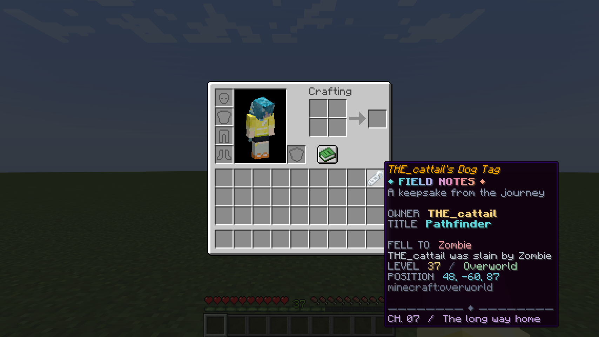

# 自定义狗牌信息

[English](customization.md)

本教程及配套示例使用 Minecraft 1.21.1 的 Kill Confirmed 1.0.1。

## 狗牌的交付方式

首次启动游戏或服务器后，会生成 `config/kill_confirmed.json`。关闭游戏或服务器后编辑文件，再重新启动使修改生效。多人游戏修改服务端的文件，单人游戏修改游戏目录中的文件。

`drop_strategy` 可选：

| 值 | 效果 |
| --- | --- |
| `AT_DEATH_POSITION` | 在死亡位置掉落，默认值。 |
| `ON_RESPAWN_INVENTORY` | 重生后放入玩家物品栏；放不下时掉落在重生位置。 |

配置作用于之后生成的狗牌。已有狗牌保留生成时记录的信息和排版。

## 选择记录的信息

`lore_template` 是按显示顺序排列的提示文本。每行在 `component` 中填写 Minecraft JSON 文本组件，用仅含 `placeholder` 的节点插入死亡记录：

```json
{
  "drop_strategy": "AT_DEATH_POSITION",
  "lore_template": [
    {
      "component": {
        "text": "玩家：",
        "color": "gold",
        "italic": false,
        "extra": [{"placeholder": "kill_confirmed:owner"}]
      }
    },
    {
      "when": "kill_confirmed:killer",
      "component": {
        "text": "击杀者：",
        "color": "red",
        "italic": false,
        "extra": [{"placeholder": "kill_confirmed:killer"}]
      }
    }
  ]
}
```

狗牌名称本身已包含所属玩家，可以按需再添加玩家信息行。

| 占位符 | 信息 |
| --- | --- |
| `kill_confirmed:owner` | 死亡玩家的显示名称 |
| `kill_confirmed:killer` | 击杀者的显示名称，有击杀者时可用 |
| `kill_confirmed:death_message` | 游戏的死亡消息 |
| `kill_confirmed:coordinates` | 死亡坐标 |
| `kill_confirmed:dimension` | 维度显示名称 |
| `kill_confirmed:dimension_id` | 维度 ID，例如 `minecraft:overworld` |
| `kill_confirmed:level` | 死亡时的经验等级 |

`when` 指定某个占位符存在时才显示整行。击杀者等可选信息应使用它，例如环境导致的死亡可能没有击杀者。没有条件保护的占位符缺失时，会产生模板错误。

## 颜色、排版与本地化

可使用文本组件的 `color`、`bold`、`italic`、`underlined`、`extra`、`translate` 等字段，颜色也支持 `#64D8DD` 这样的十六进制写法。空行可写成 `{"component":{"text":""}}`。

占位符节点本身只写 `{"placeholder":"命名空间:键"}`，样式放在外层组件中：

```json
{
  "component": {
    "text": "等级  ",
    "color": "gray",
    "italic": false,
    "extra": [
      {
        "text": "",
        "color": "#F5D282",
        "bold": true,
        "extra": [{"placeholder": "kill_confirmed:level"}]
      }
    ]
  }
}
```

内建信息保留原有文本组件，包括样式和翻译键。[默认配置](examples/default/kill_confirmed.json)的标签使用翻译键；自定义模板中直接填写的文字会原样显示。

## 复现截图中的复杂展示

1. 关闭游戏或服务器，备份现有配置。
2. 用 [Field Notes 示例配置](examples/showcase/kill_confirmed.json)替换 `config/kill_confirmed.json`。
3. 下载 [field-notes.zip](examples/showcase/field-notes.zip?raw=true)，保持 ZIP 格式，放入世界的 `datapacks` 目录。
4. 重新启动，通过正常游戏中的死亡生成一枚新的狗牌。

示例组合了渐变标题、分区排版、条件显示和死亡记录。配套数据包提供了装饰性称号 **Pathfinder** 与章节 **CH. 07 / The long way home**，可以在[对应函数](examples/showcase/field-notes/data/showcase/function/tag_details.mcfunction)中换成自己世界的文字。



恢复默认布局时，换回[默认配置](examples/default/kill_confirmed.json)并重新启动即可。

## 用数据包增加信息

在 `data/kill_confirmed/tags/function/placeholder_providers.json` 中注册函数：

```json
{"values":["example:tag_details"]}
```

创建 `data/example/function/tag_details.mcfunction`：

```mcfunction
data modify storage kill_confirmed:scratch output append value {id:"example:rank",component:'{"text":"探路者","color":"aqua"}'}
```

然后在 `lore_template` 中引用它：

```json
{
  "when": "example:rank",
  "component": {
    "text": "称号：",
    "italic": false,
    "extra": [{"placeholder": "example:rank"}]
  }
}
```

每个函数以死亡玩家的身份执行，可以从 `storage kill_confirmed:scratch input` 读取死亡快照，并向 `output` 追加结果。自定义键使用自己的命名空间；`kill_confirmed` 保留给内建字段。输出中的 `component` 是 JSON 文本组件字符串。

Minecraft 1.21.1 的 1.0.1 版中，在另一个命令函数内触发死亡时，可能无法记录数据包提供的字段。截图示例使用僵尸自然攻击造成的死亡验证。

完整的快照结构、输出限制和 Java 扩展方式见 [Integration reference](integration.md)。
